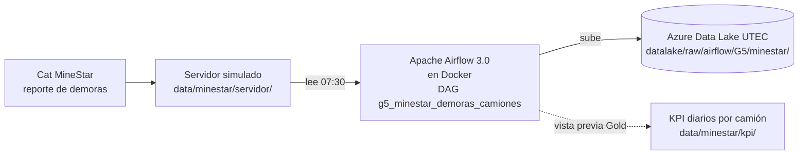

# G5 · Ingesta diaria de demoras de camiones (MineStar) a la zona Raw

Proyecto integrador (avance) del curso de Ingeniería de Datos, Grupo 5.

## 1. Problema de negocio

En una operación minera de cobre a tajo abierto de gran escala, la flota de acarreo mueve unas **500 000 t de material por día**. La flota tiene **46 camiones**:

| Serie | Modelo | Unidades | Equipos |
|---|---|---|---|
| CM100 | CAT 797F | 28 | CM101–CM116, CM118, CM120–CM130 |
| CM400 | Komatsu 980E | 10 | CM401–CM410 |
| CM500 | CAT 798 | 8 | CM501–CM508 |

Cada parada de un camión (mantenimiento, cambio de turno, falta de pala, clima…) queda registrada en **Cat MineStar** como una *demora* con categoría y subcategoría.

Hoy los KPI diarios de desempeño de la flota se arman **a mano**:
- alguien exporta las demoras de MineStar;
- las consolida en Excel;
- calcula la disponibilidad y la utilización.

Esto genera tres problemas:
- **Reportes tardíos:** el KPI del día llega horas o días después del cierre del turno.
- **Errores sin trazabilidad:** demoras que cruzan la medianoche o el cambio de turno se cuentan dos veces o se pierden.
- **Decisiones a ciegas:** con 1 punto de disponibilidad física (DF) en juego cada día, el negocio no puede reaccionar a tiempo.

**Objetivo del avance:** automatizar la carga diaria de las demoras de camiones desde el servidor de MineStar (simulado) hasta la **zona Raw** del Data Lake de la UTEC, con calidad de ingreso y trazabilidad. Esta es la base del *data product* de KPI de flota del proyecto final.

## 2. Datos que se ingieren

**Reporte de demoras de MineStar, flota `Truck Classes`, de enero a octubre de 2026.**
- Unas **430 demoras por día** y unas 128 000 filas en el año.
- Cada archivo diario pesa ~70 KB.

| Columna MineStar | Uso |
|---|---|
| `Equipo` | Camión (CMxxx) → serie y modelo |
| `Categoría Demora` / `Subcategoría Demora` | Clasificación en el modelo de tiempos |
| `Inicio Demora` / `Fin Demora` | Ventana de la parada (`Active Delay` = parada aún abierta) |
| `OID Minestar` / `ID Datamart` | Identificadores únicos (control de duplicados) |

**Servidor simulado.** MineStar deja un archivo por día operativo en `data/minestar/servidor/AAAA/MM/demoras_camiones_AAAAMMDD.csv`. El día operativo va de **07:00 a 07:00**, alineado con el cambio de turno. Se genera a partir de las exportaciones originales con:

```bash
docker exec dsai-de-airflow-airflow-scheduler-1 bash -c "cd /opt/airflow && python -m scripts.g5_minestar.simular_servidor --desde 2026-01-01"
```

> **Confidencialidad:** los datos son de una operación real. La carpeta `data/` está en `.gitignore`, así que **ningún archivo de datos se sube a GitHub**; solo viajan al Data Lake de la UTEC. El repositorio contiene únicamente código.

## 3. Arquitectura conceptual



| Componente | Rol | Por qué |
|---|---|---|
| Servidor simulado | Carpeta con un CSV por día operativo | Reproduce cómo MineStar deja su reporte, sin depender del sistema productivo |
| Apache Airflow 3.0 (Docker) | Programa, ejecuta y registra el DAG | Reintentos, logs, historial y reprocesos por fecha; el mismo entorno para todo el equipo |
| Azure Data Lake (Raw) | Guarda cada día en `raw/airflow/G5/minestar/...` | Barato, durable y escalable; es la base del medallion Raw → Silver → Gold |
| GitHub + Gitflow | Versiona el código | Cambios revisados por Pull Request hacia `develop` |

## 4. Pipeline (DAG `g5_minestar_demoras_camiones`)

**Frecuencia:** todos los días a las **07:30 (hora de Lima)**, `cron 30 7 * * *`. El día operativo cierra con el cambio de turno de las 07:00. Configuración: `catchup=False`, `max_active_runs=1`.

```
resolver_fecha → detectar_archivo → validar → normalizar ┬→ cargar_a_raw
                                                         └→ calcular_kpis
```

| Tarea | Qué hace | Error que contempla y cómo se maneja |
|---|---|---|
| `resolver_fecha` | Calcula el último día operativo cerrado o usa el parámetro `fecha_operativa` (reproceso manual) | Fecha mal escrita → falla con un mensaje claro |
| `detectar_archivo` | Busca `demoras_camiones_AAAAMMDD.csv` del día | El archivo no llegó o está vacío → falla; **2 reintentos cada 10 min** (MineStar puede exportar tarde) |
| `validar` | Revisa columnas, filas y fechas legibles, y que el fin no sea anterior al inicio | Si cambia el esquema → falla indicando qué columnas faltan. Duplicados, demoras abiertas, categorías o camiones nuevos → *warning* en el log |
| `normalizar` | Transformación mínima (detalle abajo) | Re-ejecutar no duplica, porque deduplica por `OID Minestar` |
| `cargar_a_raw` | Sube el archivo a `datalake/raw/airflow/G5/minestar/demoras_camiones/anio=AAAA/mes=MM/` | Error de Azure → **3 reintentos cada 5 min**; sobrescribe (idempotente) |
| `calcular_kpis` | Vista previa de Gold: KPI por camión, por serie y de la flota | Camiones sin demoras cuentan con 24 h efectivas |

**Transformación mínima en `normalizar`:**
- Quita duplicados por `OID Minestar`.
- Recorta cada demora a la ventana 07:00–07:00 del día. Así una parada larga (p. ej. un PM de 27 h) se reparte entre los días que toca.
- Cierra las demoras `Active Delay` al final de la ventana y las marca con `demora_activa`.
- Asigna el `grupo_tiempo` y la serie del camión.
- Agrega columnas de linaje: `fecha_operativa`, `archivo_origen`, `fec_carga`.
- Conserva todas las columnas originales de MineStar.

**Reproceso de un día:** en Airflow, *Trigger DAG w/ config* → `{"fecha_operativa": "2026-10-25"}`.

## 5. KPI de desempeño (modelo de tiempos ASARCO)

| Grupo de tiempo | Categorías MineStar |
|---|---|
| **Mantenimiento** (no disponible) | Mant-Programado, Mant-No-Programado |
| **Reserva** (disponible, sin operar) | Condicion-Operativa, Factor-Externo, Fuera de Plan |
| **Demora** (operativo, sin producir) | Demora-Programada, Demora-No-Programada, Paradas-Operacionales |

Definiciones de tiempo:
- `Calendario (24 h) = Disponible + Mantenimiento`
- `Disponible = Operativo + Reserva`
- `Operativo = Efectivo + Demora`

| KPI | Fórmula |
|---|---|
| Disponibilidad física (DF) | Disponible / Calendario |
| Utilización (UT) | Operativo / Disponible |
| Eficiencia operativa (EF) | Efectivo / Operativo |
| Uso efectivo | Efectivo / Calendario |
| MTTR | Horas de Mant-No-Programado / N° de fallas |
| MTBF | Horas operativas / N° de fallas |

**Resultado 2026** (298 días operativos, del 01/01 al 25/10):

| KPI | Valor |
|---|---|
| DF | 89,4 % |
| UT | 96,6 % |
| EF | 81,6 % |
| Horas efectivas de flota | ~778 h/día |
| Fallas | ~17 por día |
| MTTR | ~3,0 h |

**Por serie:**

| Serie | Modelo | DF |
|---|---|---|
| CM100 | CAT 797F | 88,5 % |
| CM400 | Komatsu 980E | 88,9 % |
| CM500 | CAT 798 | 93,0 % |

## 6. Cómo ejecutarlo

1. Levantar Airflow: `docker compose up --build -d`, luego entrar a `localhost:8080`.
2. Crear la conexión **`utec_blob_storage`**: tipo `wasb`, con Extra `{"connection_string": "..."}` del enunciado.
3. Copiar las exportaciones de MineStar a `data/minestar/exportaciones/` y correr `simular_servidor` (sección 2).
4. Activar el DAG `g5_minestar_demoras_camiones`, o dispararlo con `{"fecha_operativa": "AAAA-MM-DD"}`.

## 7. Estructura del código

```
dags/g5_minestar_demoras_camiones.py   # definición del DAG (tareas y frecuencia)
scripts/g5_minestar/config.py          # rutas, esquema, modelo de tiempos, flota
scripts/g5_minestar/pipeline.py        # lógica: detectar, validar, normalizar, cargar, KPI
scripts/g5_minestar/simular_servidor.py# genera el servidor simulado (1 archivo por día)
docs/g5_minestar/README.md             # este documento
```

## 8. Próximos pasos (proyecto final · Data Mesh)

- **Silver:** demoras tipadas y deduplicadas, con un maestro de equipos (modelo, capacidad).
- **Gold:** `kpi_flota_diario` (DF, UT, EF, MTBF, MTTR) por camión, serie y turno, más un Pareto de causas.
- **Data product:** "KPI de flota de acarreo".
  - **Dominio dueño:** Mantenimiento Mina.
  - **Consumidores:** Operaciones (despacho), Planeamiento y Gerencia.
